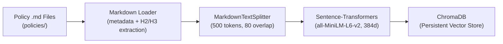
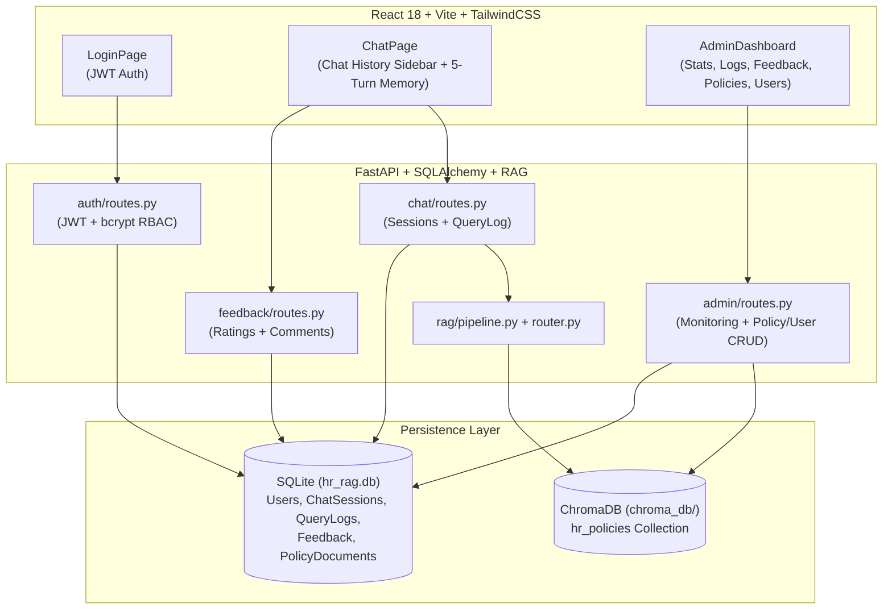

# PolicyPilot — Production-Ready HR Policy RAG Assistant


---

## Executive Summary

**PolicyPilot** is a full-stack, production-ready **Retrieval-Augmented Generation (RAG)** assistant purpose-built for **enterprise HR policy question-answering**. Rather than running flat vector search across every document, PolicyPilot uses a **2-stage hierarchical document router** to isolate the right policy file first (via keyword/header matching with an LLM semantic fallback and an out-of-scope rejection gate), and then executes **targeted hybrid retrieval** (ChromaDB semantic search + BM25 keyword search fused with **Reciprocal Rank Fusion** and re-ranked via **Maximum Marginal Relevance**) strictly within that document.

Every response is grounded in retrieved policy chunks, scored for retrieval confidence (`High`, `Medium`, `Low`, or `Fallback`), sanitized by an output guardrail layer, and logged in real time to SQLite. The platform ships with **multi-turn chat history** (sessions named after the first question asked, with **5-turn conversational memory** per chat), **role-based access control (RBAC)** for Employees and HR Admins, and a **real-time Admin Monitoring & Evaluation Dashboard** tracking query logs, confidence scores, fallback rates, policy usage heatmaps, and user helpfulness ratings.

---

## Business Problem

HR teams in growing organizations handle **hundreds of repetitive policy questions every week** — leave accrual, carryover limits, remote work stipends, health benefits, onboarding checklists, performance review cycles, and code-of-conduct rules. Relying on manual HR ticket triage is:

- **Slow** — hours of turnaround time for answers that already exist in policy handbooks.
- **Inconsistent** — different HR representatives may summarize edge cases differently.
- **Hard to audit** — manual chat replies lack standardized policy section citations.
- **Unscalable** — HR support load scales linearly with employee headcount.

Standard LLMs alone cannot solve this because they **hallucinate** company-specific numbers and rules. PolicyPilot solves this by grounding every answer in the organization's actual Markdown policy documents, enforcing strict citation and confidence gates, and rejecting out-of-scope queries before generation.

---

## Architecture

### Data Ingestion Pipeline



### 2-Stage Query & Retrieval Pipeline

```mermaid
flowchart LR
    Q["User Question<br/>(+ Last 5 Chat Turns)"] --> R1["Stage 1: Keyword & Header Router<br/>(Titles, Filenames, H2/H3)"]
    R1 -->|Ambiguous| R2["Stage 2: LLM Semantic Router<br/>(Groq Cloud Classifier)"]
    R1 -->|Matched| HYB
    R2 -->|Out-of-Scope| FB["Early Rejection Gate<br/>(Fallback Response)"]
    R2 -->|"Matched Files"| HYB["Targeted Hybrid Retrieval<br/>(ChromaDB Top-10 + BM25 Top-10)"]
    HYB --> RRF["Reciprocal Rank Fusion<br/>(k=60, Top-10)"]
    RRF --> MMR["MMR Re-ranking<br/>(lambda=0.7, Top-5)"]
    MMR --> CONF["Weighted Confidence Gate<br/>(0.7 * top1 + 0.3 * top2)"]
    CONF -->|"< 0.25"| FB
    CONF -->|">= 0.25"| LLM["Groq LLM Generation<br/>(openai/gpt-oss-120b, temp=0.1)"]
    LLM --> CLEAN["Output Guardrail & Sanitizer<br/>(No HTML/Tables, Anonymized)"]
    CLEAN --> RES["Structured Answer + Citations + Log"]
```



### Full-Stack System Overview



---

## Policy Knowledge Base

The system ships with **6 structured HR policy documents** in `policies/` (automatically ingested into **44 chunks** in ChromaDB on startup):

| # | Document | Topic | Chunks | Key Sections Covered |
|---|----------|-------|--------|----------------------|
| 1 | `benefits_handbook.md` | Benefits & Wellness | 8 | Medical, dental, vision, 401(k), wellness stipends |
| 2 | `code_of_conduct.md` | Ethics & Conduct | 9 | Workplace standards, conflicts of interest, reporting |
| 3 | `onboarding_guide.md` | Employee Onboarding | 7 | First-day setup, 30/60/90-day milestones, training |
| 4 | `performance_review_policy.md` | Performance Reviews | 8 | Review cycles, rating criteria, PIPs, promotions |
| 5 | `remote_work_policy.md` | Remote & Hybrid Work | 6 | Eligibility, core hours, equipment, security |
| 6 | `vacation_leave_policy.md` | Vacation & Leave | 6 | PTO accrual, carryover, sick leave, holidays |

---

## RAG Pipeline & Retrieval Design

### 1. Markdown-Aware Chunking (`backend/rag/loader.py`)
- **Splitter**: `MarkdownTextSplitter` (from `langchain_text_splitters`)
- **Chunk Size**: `500` tokens (measured with `tiktoken` `cl100k_base`, with a word-count fallback in offline environments)
- **Chunk Overlap**: `80` tokens
- **Metadata Enrichment**: Every chunk retains `source` (filename), `policy_title`, `policy_number`, `effective_date`, `version`, `section` (`##`), and `subsection` (`###`) for accurate inline citations.

### 2. Two-Stage Hierarchical Document Router (`backend/rag/router.py`)
1. **Keyword & Header Match**: Tokenizes the user query (filtering stopwords) and scores each policy file against exact H2/H3 heading phrases (`+6.0`), title/filename tokens (`+3.0`), and heading tokens (`+1.5`). Selects top 1–2 files if score `>= 3.0`.
2. **LLM Semantic Fallback**: When keyword matching is ambiguous (or for conversational follow-up questions), a fast Groq Cloud classifier inspects the policy catalog and the recent chat history to select 1–2 relevant files—or rejects unrelated queries (`is_hr_related: false`).

### 3. Targeted Hybrid Retrieval & Re-ranking (`backend/rag/pipeline.py`, `embedder.py`)
- **Embedding Model**: `sentence-transformers/all-MiniLM-L6-v2` (384 dimensions, fast CPU inference).
- **Semantic Search**: ChromaDB cosine similarity search filtered strictly to `selected_files` (`top_k = 10`).
- **Lexical Search**: `BM25Okapi` keyword search (`rank-bm25`) over chunks belonging only to `selected_files` (`top_k = 10`).
- **Reciprocal Rank Fusion (RRF)**: Merges semantic and BM25 rankings (`k = 60`, `top_k = 10`).
- **Maximum Marginal Relevance (MMR)**: Re-ranks the 10 fused candidates (`lambda = 0.7`) to select the **top 5** most relevant and non-redundant chunks passed to the LLM.

### 4. Confidence Scoring & Thresholds
Confidence is computed as a weighted cosine similarity over the top two re-ranked chunks:
`confidence_score = 0.7 * top1 + 0.3 * top2`

| Score Range | Label | Meaning |
|-------------|-------|---------|
| `>= 0.55` | High | Strong semantic alignment with policy excerpts |
| `0.40 – 0.54` | Medium | Solid match across relevant policy sections |
| `0.25 – 0.39` | Low | Partial match; answer provided with caution |
| `< 0.25` | Fallback | Insufficient confidence; returns safe HR contact fallback |

### 5. Answer Generation (`openai/gpt-oss-120b` via Groq Cloud)
- **Temperature**: `0.1` (`max_tokens = 1536`) for deterministic, factual responses.
- **Structured Output**: Prompt enforces **Overview → Key Rules & Entitlements → Procedure → Policy Reference**.

---

## Multi-Turn Chat History & 5-Turn Memory

PolicyPilot persists employee and admin conversations in SQLite (`ChatSession` + `QueryLog`):
- **Automatic Naming**: Each new chat session is automatically named after the **first question** the user asked.
- **Timestamps & History Sidebar**: The left sidebar displays all past sessions with formatted timestamps and message counts, allowing users to revisit or delete conversations and start a **New Chat** anytime.
- **5-Turn Conversational Memory**: When continuing an existing chat (`session_id`), the backend loads the **past 5 conversation turns** (`question` + `answer`) in chronological order and supplies them to both the document router and the LLM prompt so follow-up questions (e.g., *"What about part-time employees?"*) resolve seamlessly.

---

## Guardrails & Anti-Hallucination

PolicyPilot enforces a **multi-layer guardrail architecture**:
1. **Input Routing Gate**: Unrelated queries (weather, coding, stock prices, general trivia) are blocked in `router.py` before vector search or answer generation.
2. **Confidence Gate**: Queries scoring below `0.25` bypass LLM generation and return a deterministic fallback directing the employee to HR.
3. **Strict Grounding Prompt**: Instructs the LLM to answer exclusively from the retrieved policy excerpts, never fabricate rules, and never output raw HTML or Markdown pipe-tables.
4. **Output Sanitizer (`_clean_response_text`)**: Strips any stray HTML tags (`<br>`, `<b>`, `<table>`), removes pipe-table formatting, and redacts hardcoded company names (replacing them with `"the Company"`).
5. **RBAC Security**: Protected routes enforce JWT verification and role checks (`employee` vs `admin`).

---

## Real-Time Production Evaluation & Monitoring

Every production interaction is instrumented for continuous quality evaluation:

| Capability | How It Works in Production |
|------------|----------------------------|
| **Live Confidence Tagging** | Every answer carries a calibrated confidence score and badge (`High` / `Medium` / `Low` / `Fallback`). |
| **Full Query Audit Log** | Every question, generated answer, retrieved sources, confidence score, and response latency (`ms`) is persisted in `query_logs`. |
| **Employee Feedback Loop** | Employees rate answers (`👍` / `👎` + optional comment) via `POST /api/feedback`. |
| **Admin Monitoring Dashboard** | Real-time tabs for **Stats** (total queries, helpful rate, avg confidence, fallback rate, policy usage heatmap), **Query Logs** (paginated + confidence filter + expandable answers/sources), **Feedback**, **Policies** (upload/delete `.md` with live ChromaDB re-indexing), and **Users** (create/remove employees and other admins). |

### Offline Evaluation Benchmark
Tested across a 30-question curated evaluation suite (23 in-scope HR questions + 7 out-of-scope questions):
- **In-Scope Policy Accuracy**: **95.7%**
- **Out-of-Scope Rejection Accuracy**: **100%** (all non-HR questions blocked at the gate)

---

## Tech Stack

| Layer | Technology |
|-------|------------|
| **Frontend** | React 18, Vite 5, TailwindCSS, React Router v6, Axios, `react-markdown`, `remark-gfm` |
| **Backend** | Python 3.10+, FastAPI, Uvicorn, Pydantic Settings |
| **Authentication** | JWT (`python-jose`), `bcrypt` password hashing, RBAC (`employee` / `admin`) |
| **RAG & Retrieval** | `langchain-text-splitters`, `sentence-transformers` (`all-MiniLM-L6-v2`), ChromaDB, `rank-bm25` |
| **LLM Inference** | Groq Cloud (`openai/gpt-oss-120b`) |
| **Relational Database** | SQLite with SQLAlchemy ORM (`users`, `chat_sessions`, `query_logs`, `feedback`, `policy_documents`) |

---

## Project Structure

```
hr_rag/
├── backend/
│   ├── main.py                  # FastAPI entry point + lifespan auto-ingestion
│   ├── config.py                # Pydantic BaseSettings configuration
│   ├── requirements.txt         # Python dependencies
│   ├── .env.example             # Environment variable template
│   ├── auth/
│   │   ├── routes.py            # Login, register, current user
│   │   ├── schemas.py
│   │   └── utils.py             # JWT + bcrypt + RBAC dependencies
│   ├── chat/
│   │   ├── routes.py            # /api/chat + /api/chat/sessions (5-turn memory)
│   │   └── schemas.py
│   ├── feedback/
│   │   ├── routes.py            # Thumbs up/down + comments
│   │   └── schemas.py
│   ├── admin/
│   │   ├── routes.py            # Stats, query logs, feedback, policy & user CRUD
│   │   └── schemas.py
│   ├── db/
│   │   ├── database.py          # SQLAlchemy engine & session
│   │   ├── models.py            # User, ChatSession, QueryLog, Feedback, PolicyDocument
│   │   └── init_db.py           # Table creation, lightweight migrations, seed users
│   └── rag/
│       ├── loader.py            # Markdown-aware chunking & metadata extraction
│       ├── embedder.py          # MiniLM embeddings + ChromaDB operations
│       ├── router.py            # 2-stage hierarchical policy router
│       └── pipeline.py          # Hybrid retrieval (RRF + MMR) + Groq generation
├── frontend/
│   ├── package.json
│   ├── vite.config.js           # Vite config + /api proxy to :8000
│   └── src/
│       ├── api/axios.js         # Axios instance with JWT interceptor
│       ├── context/AuthContext.jsx
│       ├── components/
│       │   ├── CitationList.jsx
│       │   ├── ConfidenceBadge.jsx
│       │   ├── FeedbackWidget.jsx
│       │   ├── FormattedMessage.jsx
│       │   ├── LoadingDots.jsx
│       │   └── ProtectedRoute.jsx
│       └── pages/
│           ├── LoginPage.jsx
│           ├── ChatPage.jsx     # Chat UI + history sidebar + suggested prompts
│           └── AdminDashboard.jsx
├── policies/                    # Markdown HR policy files
├── .gitignore
└── README.md
```

---

## How to Run

### Prerequisites
- **Python 3.10+**
- **Node.js 18+** and `npm`
- A **[Groq Cloud](https://console.groq.com)** API key

### 1. Configure Environment Variables
```powershell
cd c:\Users\raghu\Downloads\hr_rag\backend
copy .env.example .env
```
Edit `backend/.env` and set your keys:
```env
GROQ_API_KEY=gsk_your_groq_api_key_here
SECRET_KEY=your-long-random-jwt-secret
```

### 2. Start the Backend (from the project root)
```powershell
cd c:\Users\raghu\Downloads\hr_rag
python -m venv backend\venv
.\backend\venv\Scripts\activate
pip install -r backend\requirements.txt
uvicorn backend.main:app --host 0.0.0.0 --port 8000 --reload
```
On first startup, the backend automatically initializes `hr_rag.db`, seeds default accounts, and ingests all `.md` files from `policies/` into `chroma_db/`.

### 3. Start the Frontend (in a new terminal)
```powershell
cd c:\Users\raghu\Downloads\hr_rag\frontend
npm install
npm run dev
```
- **Frontend UI**: [http://localhost:5173](http://localhost:5173)
- **Backend API Docs (Swagger)**: [http://localhost:8000/docs](http://localhost:8000/docs)

---

## Default Login Accounts

| Role | Email | Password |
|------|-------|----------|
| **Admin** | `admin@company.com` | `Admin@123` |
| **Employee** | `employee@company.com` | `Employee@123` |

> Change these default credentials before deploying to production.

---

## API Reference

| Group | Method | Endpoint | Access |
|-------|--------|----------|--------|
| **Auth** | `POST` | `/api/auth/login` | Public |
| **Auth** | `GET` | `/api/auth/me` | Authenticated |
| **Auth** | `POST` | `/api/auth/register` | Admin only |
| **Chat** | `POST` | `/api/chat` | Employee + Admin |
| **Chat** | `GET` | `/api/chat/sessions` | Employee + Admin |
| **Chat** | `GET` | `/api/chat/sessions/{session_id}` | Employee + Admin |
| **Chat** | `DELETE` | `/api/chat/sessions/{session_id}` | Employee + Admin |
| **Feedback** | `POST` | `/api/feedback` | Employee + Admin |
| **Admin** | `GET` | `/api/admin/stats` | Admin only |
| **Admin** | `GET` | `/api/admin/queries` (alias `/logs`) | Admin only |
| **Admin** | `GET` | `/api/admin/feedback` | Admin only |
| **Admin** | `GET` | `/api/admin/policies` | Admin only |
| **Admin** | `POST` | `/api/admin/policies/upload` | Admin only |
| **Admin** | `DELETE` | `/api/admin/policies/{policy_identifier}` | Admin only |
| **Admin** | `GET` | `/api/admin/users` | Admin only |
| **Admin** | `POST` | `/api/admin/users` | Admin only |
| **Admin** | `DELETE` | `/api/admin/users/{user_id}` | Admin only |

---

## Limitations & Future Improvements

- **Synthetic Policy Data**: The included `.md` files are synthetic corporate policies for demonstration.
- **English-Only**: Currently tuned for English policy documents and queries.
- **Markdown Input**: Policy uploads currently accept `.md` files (PDF/DOCX ingestion can be added in `rag/loader.py`).
- **Cloud Migration Path**: Replace SQLite with PostgreSQL and containerize with Docker for horizontal scaling on AWS ECS, GCP Cloud Run, or Render.
